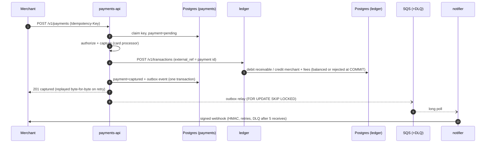

# FinCore — a production-grade payment platform on AWS EKS

FinCore is a small but real payment platform (card payments, a double-entry ledger, merchant webhooks) and the platform that runs it. The platform covers GitOps, progressive delivery with automatic rollback, autoscaling, and infrastructure as code for AWS. Everything also runs locally on `kind`, so every claim below can be reproduced on a laptop without an AWS bill.

> **Status: Phase 1 (platform core) is complete and verified on kind.** Phase 2 (security and compliance) and Phase 3 (reliability, observability, cost) are next. The AWS stack has passed static validation but has **not been applied yet**. AWS numbers (load test, RTO/RPO, cost per day) will be added after a single recorded demo day on a dedicated account.

## What happens to a payment



| Guarantee | How | Proof |
|---|---|---|
| Retries never double-charge | `Idempotency-Key` per merchant, request fingerprint, byte-exact replay, 409 while in flight, stale-lock takeover resumes from the current state | `services/payments-api/internal/payments/service_test.go`, `scripts/e2e.sh` |
| Money is never created or lost | Ledger entries are balanced **by PostgreSQL** (deferred constraint triggers at COMMIT) and append-only; balances are derived, never stored | `services/ledger/internal/ledger/store_test.go` (raw SQL bypassing the app is rejected) |
| Illegal state changes are impossible | `pending → authorized → captured \| failed` is enforced in code and by a DB trigger | `state_test.go`, `TestDatabaseRejectsIllegalTransition` |
| Events are not lost | Transactional outbox and at-least-once delivery; the receiver deduplicates on event ID | `TestCreateCapturesAndWritesOutbox`, `notifier_test.go` |

## What happens on a deploy

1. CI tests, builds, scans (Trivy), and pushes the image to ECR using GitHub OIDC (no static keys). It then commits the new tag to `gitops/envs/aws/values/`.
2. Argo CD syncs. Argo Rollouts shifts 10% → 30% → 60% → 100% of traffic (ALB weighted target groups on AWS).
3. In the background, an AnalysisRun queries Prometheus for **canary pods only**: success rate ≥ 99% and p95 ≤ 300 ms. If there is no data yet, the result is *inconclusive*, never a pass.
4. If a bad build fails analysis, the canary is aborted and scaled to zero automatically, and stable keeps serving.

Verified on kind (`docs/phase-1-results.md`):

| Release | Outcome | Time | Canary success rate (measured) |
|---|---|---|---|
| Healthy build | promoted 10 → 30 → 60 → 100% | 233 s | 1.0 in 6 of 6 measurements |
| Bad build (50% injected HTTP 500) | **aborted automatically**, canary scaled to 0, stable untouched | **109 s** from commit | 0.47, 0.45 |

The end-to-end payment (`make e2e`) passes on a fresh cluster, and every static check is green. Evidence: [`docs/phase-1-results.md`](docs/phase-1-results.md).

## Run it locally

Prerequisites: Docker (≥ 4 CPU / 8 GB for the VM), Go 1.27, `kind` 0.33, `kubectl`, Helm 4.3, `yq` 4.54, `jq`, `openssl`. For `make check` you also need Terraform 1.17, tflint 0.65, checkov 3.3, kubeconform 0.8, actionlint and shellcheck. The scripts put `.tools/bin` (gitignored) first on `PATH`, so pinned binaries can live there without touching global installs.

```bash
make kind-up            # cluster (1 control plane + 3 workers in zones a/b/c), images, Argo CD, every app (~10 min first time)
make e2e                # A1: payment flows end to end
make demo-good-release  # healthy build promoted through all canary steps
make demo-bad-release   # A2: bad build rolled back automatically
make check              # A3: every static check (same as CI)
make kind-down
```

Argo CD on kind syncs from your **local commits**. An in-cluster, read-only git server serves the bind-mounted repository, and Argo CD tracks `HEAD`, the branch you have checked out. Uncommitted changes are never deployed. The demo scripts commit a release and revert it, so run them on a scratch branch if you want a clean history.

## AWS (Terraform, never applied by CI)

`terraform/bootstrap` creates the state bucket: KMS, versioned, TLS-only, with S3-native locking. `terraform/envs/demo` composes the following:

- **Network:** a VPC across 3 AZs with private nodes, flow logs, and VPC endpoints for ECR, S3, STS, SQS, and Secrets Manager.
- **EKS 1.36:** a Graviton system node group, pinned add-ons, Secrets envelope encryption with KMS, and control-plane logs.
- **Karpenter:** Spot-first NodePools with on-demand fallback, consolidation, and an interruption queue.
- **Pod Identity:** one least-privilege role per controller and per service.
- **Aurora PostgreSQL 17 Serverless v2:** a writer and a reader, with `force_ssl`.
- **SQS:** a queue and DLQ, KMS-encrypted and TLS-only.
- **ECR:** immutable tags, scan on push.
- **AWS Budgets** alerts.
- **GitHub OIDC** deploy role, scoped to this repository's `main` branch.
- **Argo CD bootstrap**, with cluster facts injected at apply time. No account IDs, endpoints, or domains live in git.

```bash
cd terraform/bootstrap && terraform init && terraform apply -var aws_account_id=<id>
cd ../envs/demo && cp terraform.tfvars.example terraform.tfvars && cp backend.hcl.example backend.hcl  # edit both
terraform init -backend-config=backend.hcl && terraform apply
```

The `allowed_account_ids` provider guard refuses to run against any other account. Teardown scripts (`scripts/up.sh` / `scripts/down.sh`) and the cost report are part of Phase 3.

## Repository layout

```
services/{payments-api,ledger,notifier}/   Go services (OpenAPI specs in api/), one Dockerfile in build/
internal/platform/                         logging, metrics, tracing, HTTP, Postgres, migrations
gitops/bootstrap/                          Argo CD values, app-of-apps chart, kind git server
gitops/charts/fincore-service/             service chart: Rollout canary + analysis, HPA, PDB, topology spread
gitops/platform/                           add-ons (values for pinned upstream charts) + small local charts
gitops/apps/, gitops/envs/{kind,aws}/      app values and per-environment overrides (image tags live here)
terraform/{bootstrap,modules,envs/demo}/   AWS infrastructure
loadtest/                                  k6 load test
scripts/                                   kind-up/down, build, deploy, e2e, demos, check
docs/plans/                                phase plans, with pinned versions and why
```
