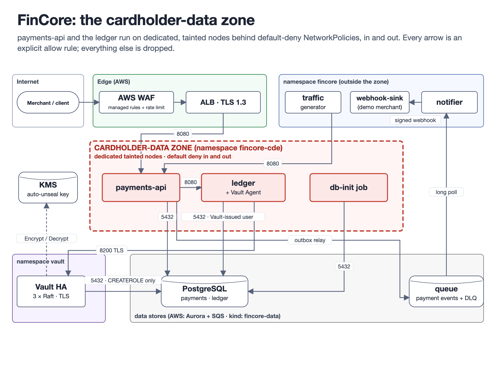
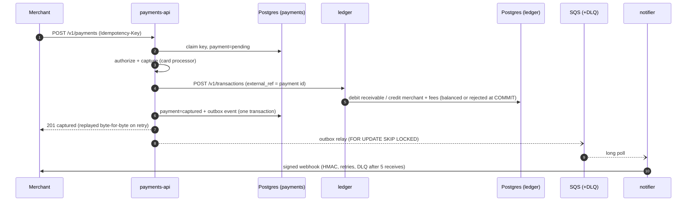
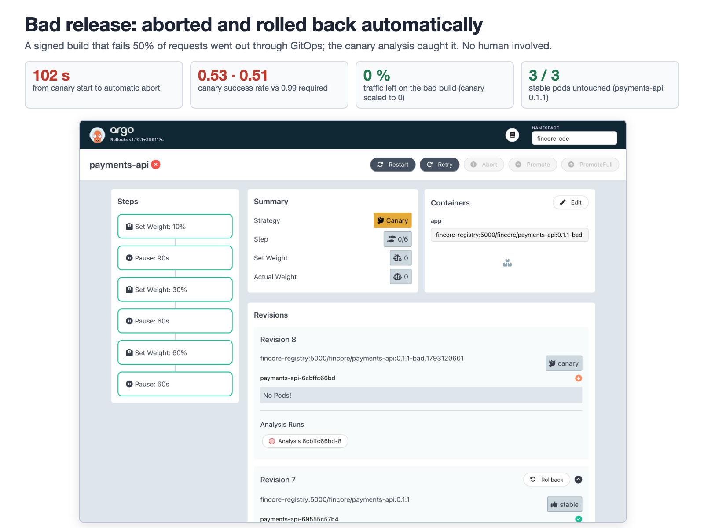
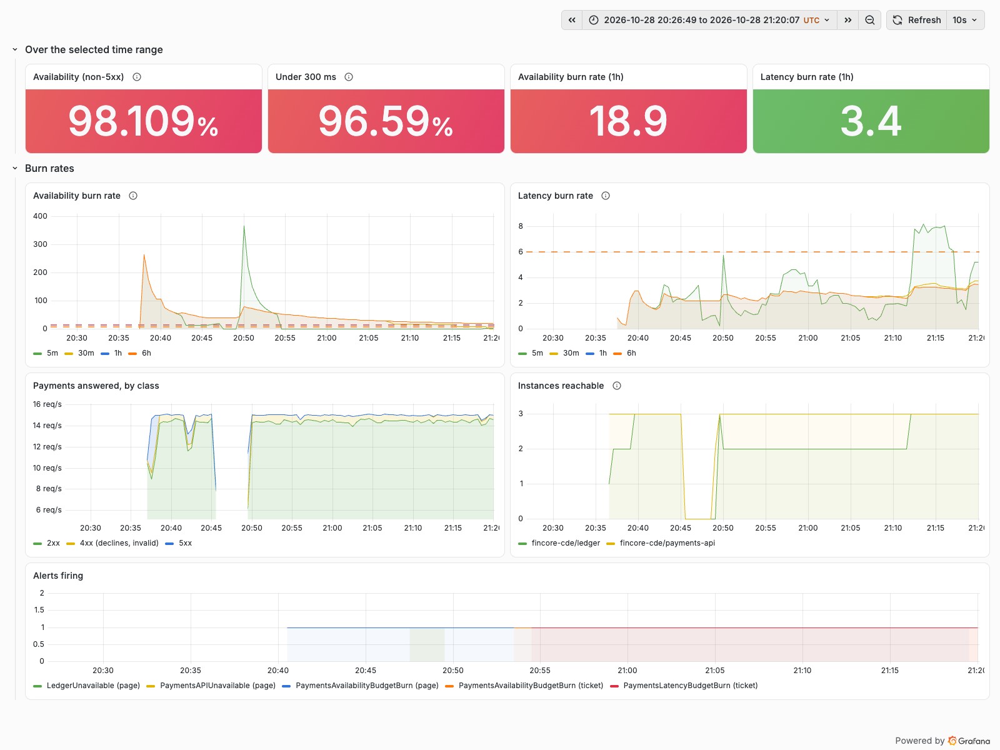
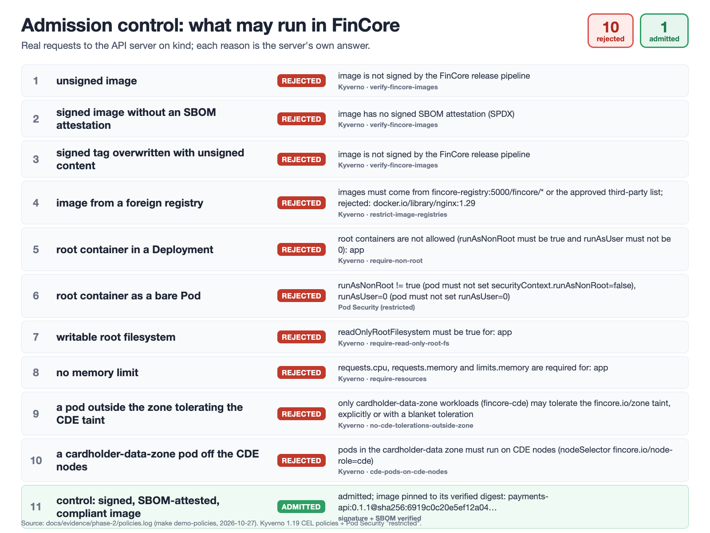
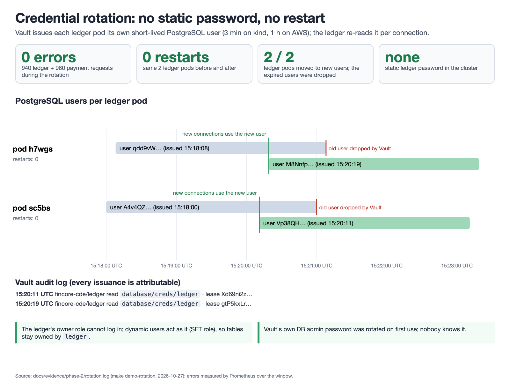
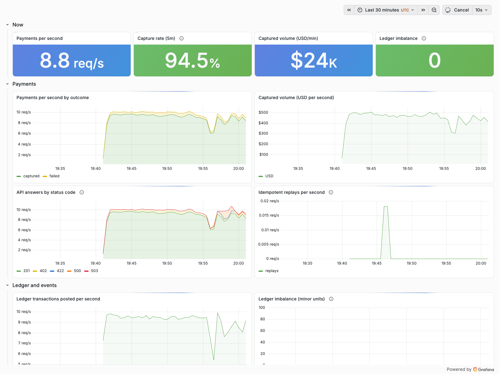
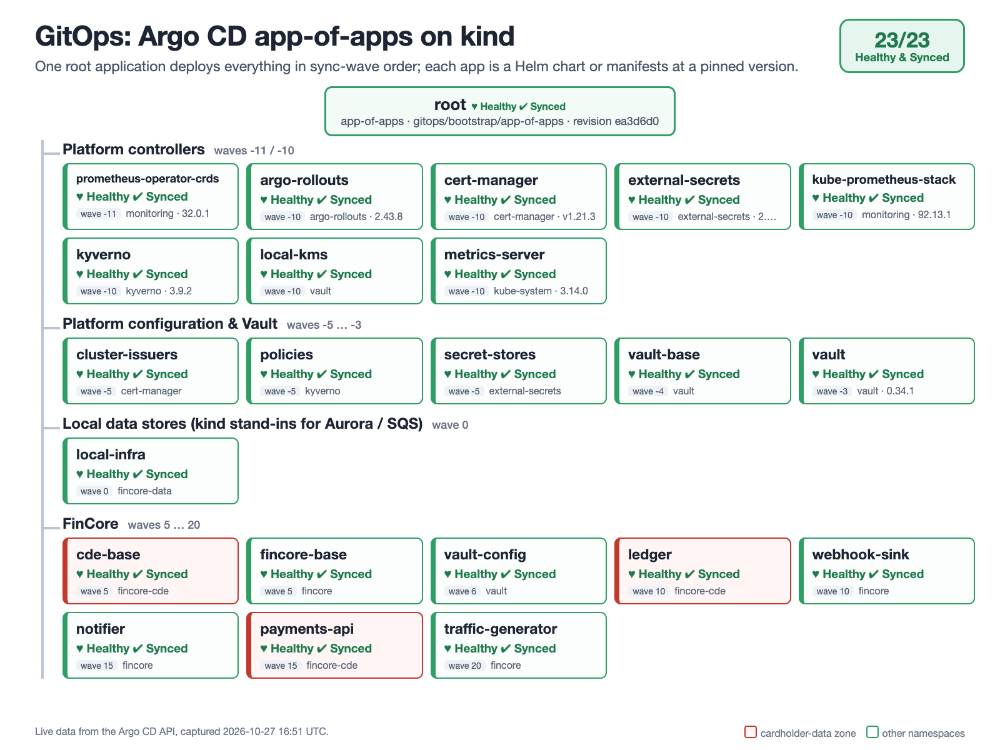

# FinCore — a production-grade payment platform on AWS EKS

FinCore is a small but real payment platform (card payments, a double-entry ledger, merchant webhooks) and everything a regulated fintech needs to run it. It has GitOps with canary releases that roll back by themselves, a cardholder-data zone isolated the way PCI DSS asks, observability with SLOs, chaos experiments, tested disaster recovery, and a cost model built from AWS's public prices.

All of it runs on a laptop with `kind`, from the same manifests the AWS environment uses, and every number below was measured there. The AWS stack (Terraform) has passed static validation and has **never been applied**: AWS numbers are list-price estimates, labelled as such.



| | Result ([evidence](docs/phase-3-results.md)) |
|---|---|
| **A bad release rolls itself back** (kind) | aborted by its canary analysis **212 s** after the commit, with no human involved |
| **The whole cluster is deleted and restored from backups** (kind) | **RTO 18 min 14 s**, **RPO 8 min 36 s**; ledger balanced, Vault back with its data |
| **A zone is lost** (kind) | paged in **~2 min**; payments back **13 s** after the zone returned; ledger balanced throughout |
| **Throughput within the SLOs** (99.9 % non-5xx, 99 % under 300 ms) | **30 payments/s** on a 6-CPU laptop VM; served up to ~70/s with p50 ≈ 130 ms |
| **AWS cost** (estimate: ap-southeast-1 list prices, idle) | **$34.39 / day**; $0.046 per 1,000 payments at demo load; small-team profile $31.69 / day |

## The problem

A payment platform has to be right before it is fast. A retry must never charge twice. Money must never appear or vanish. A bad release must not reach every customer. Card data must stay inside a zone that auditors can reason about. And when something breaks, the team has to know within minutes, act from a runbook, and be able to rebuild everything from backups. FinCore shows each of these as running code with evidence, not as a slide.

## What happens to a payment



| Guarantee | How | Proof |
|---|---|---|
| Retries never double-charge | `Idempotency-Key` per merchant, request fingerprint, byte-exact replay, 409 while in flight, stale-lock takeover resumes from the current state | `services/payments-api/internal/payments/service_test.go`, `scripts/e2e.sh` |
| Money is never created or lost | Ledger entries are balanced **by PostgreSQL** (deferred constraint triggers at COMMIT) and append-only; balances are derived, never stored | `services/ledger/internal/ledger/store_test.go` (raw SQL bypassing the app is rejected) |
| Illegal state changes are impossible | `pending → authorized → captured \| failed` is enforced in code and by a DB trigger | `state_test.go`, `TestDatabaseRejectsIllegalTransition` |
| Events are not lost | Transactional outbox and at-least-once delivery; the receiver deduplicates on event ID | `TestCreateCapturesAndWritesOutbox`, `notifier_test.go` |

## What happens on a deploy

1. CI tests, builds, scans (Trivy), and pushes the image to ECR using GitHub OIDC (no static keys). It then commits the new tag to `gitops/envs/aws/values/`.
2. Argo CD syncs. Argo Rollouts shifts 10% → 30% → 60% → 100% of traffic (ALB weighted target groups on AWS).
3. In the background, an AnalysisRun queries Prometheus for **canary pods only**: success rate ≥ 99% and p95 ≤ 300 ms. If there is no data yet, the result is *inconclusive*, never a pass.
4. If a bad build fails analysis, the canary is aborted and scaled to zero automatically, and stable keeps serving.



Verified on kind (`docs/phase-1-results.md`):

| Release | Outcome | Time | Canary success rate (measured) |
|---|---|---|---|
| Healthy build | promoted 10 → 30 → 60 → 100% | 233 s | 1.0 in 6 of 6 measurements |
| Bad build (50% injected HTTP 500) | **aborted automatically**, canary scaled to 0, stable untouched | **109 s** from commit | 0.47, 0.45 |

The end-to-end payment (`make e2e`) passes on a fresh cluster, and every static check is green. Evidence: [`docs/phase-1-results.md`](docs/phase-1-results.md). In the Phase 3 run, with the full observability and backup stack added, a bad build was aborted 212 s after its commit and a healthy one promoted in 255 s ([results](docs/phase-3-results.md#c8-phases-1-and-2-still-hold)).

## What happens in an outage

Every failure below was injected on purpose (`make chaos`) and measured from three sides: a client probe sending payments, the services' own metrics, and Alertmanager.

| Experiment | What clients saw | Server 5xx | Monthly error budget burned | Ledger balanced, outbox drained |
|---|---|---:|---:|:---:|
| Kill a payments-api and a ledger pod (no grace) | 100 % answered | 1 / 1,902 | 0 % | yes |
| Drain a node (zone a) | 95.4 %, longest gap 7 s | 249 / 3,970 | 0.63 % | yes |
| Restart PostgreSQL (an Aurora failover on AWS) | 95.7 %, longest gap 6.4 s | 62 / 2,094 | 0.24 % | yes |
| Lose zone c, the whole cardholder-data zone, for 4 minutes | total outage (kind has one CDE node; on AWS it spans 3 AZs); paged ~2 min in; back 13 s after the zone returned | 380 / 2,419 | 9.29 % | yes |



Two incidents found this way became blameless postmortems, each with a fix shipped through the same canary pipeline:
- [The ledger's own safety check took payments down](docs/postmortems/2026-10-28-ledger-invariant-scan.md) (load test)
- [A 6-second database restart caused 2 minutes of failed payments](docs/postmortems/2026-10-28-db-restart-two-minute-outage.md) (chaos experiment)

**Disaster recovery** (`make dr-drill`): the cluster was deleted while payments were flowing and rebuilt with `kind-up.sh --restore`, in this order:
1. Velero restores the secrets.
2. Vault gets its Raft snapshot, unsealed by the same KMS key.
3. PostgreSQL gets its dump.
4. Argo CD brings up everything else.

| RTO (disaster to first successful payment) | RPO (age of the newest backups) | Payments | Ledger | Vault |
|---|---|---|---|---|
| **18 min 14 s** | **8 min 36 s** | all 117,665 created before the dump are back; 4,287 after it lost, within the RPO | balanced before and after | 3/3 unsealed with its original data |

Every alert has a runbook ([`docs/runbooks/`](docs/runbooks/README.md)).

## Security and compliance

Payments and the ledger run in a **cardholder-data zone** (namespace `fincore-cde`) on dedicated, tainted nodes, behind default-deny NetworkPolicies in both directions. The diagram and every allowed flow are in [`docs/architecture.md`](docs/architecture.md). Each control is mapped to the PCI DSS v4.0.1 requirement it illustrates in [`docs/compliance-mapping.md`](docs/compliance-mapping.md); the mapping is illustrative, not a certified assessment.

| Control | How | Verified on kind ([results](docs/phase-2-results.md)) |
|---|---|---|
| Only signed images with an SBOM run | CI signs every image keyless (GitHub OIDC → Fulcio, Rekor) and attaches a signed SPDX SBOM (Syft). Kyverno verifies both at admission and pins the tag to the verified digest. | unsigned, unattested, re-tagged and foreign images rejected; signed image admitted by digest |
| No root, read-only FS, limits, zone placement | Kyverno CEL policies (also on Deployments, via autogen) plus Pod Security `restricted` | 7 more violations rejected, each with its reason (27 `kyverno test` cases in CI) |
| No static database password for the ledger | Vault (HA Raft, TLS, KMS auto-unseal) issues a PostgreSQL user per pod (3 min on kind, 1 h on AWS). The service re-reads it per connection. The root token is revoked after init. | credentials rotated under load: **0 errors in 940 ledger requests, 0 restarts**; old users dropped |
| The zone is isolated | Default-deny NetworkPolicies (VPC CNI enforcement on EKS); Aurora admits only the CDE and Vault node security groups | outside pods cannot reach the ledger, PostgreSQL or the queue; zone pods cannot reach the internet |
| Edge and audit (AWS) | AWS WAF (managed rules, rate limit), CloudTrail (multi-region, validated, 365 days), EKS control-plane logs, Vault audit device | statically checked (Terraform, checkov) |

|  |  |
|---|---|

With all of this switched on, Phase 1 still holds. A bad build was rolled back automatically in 139 s, and a healthy build was promoted in 281 s. Phase 3 found that the Vault injector's fail-closed setting had been silently ignored (a renamed chart key); it is fixed, and `make check` now asserts it on every change.

## Observability

Metrics (Prometheus), logs (Loki, via Fluent Bit) and traces (Tempo, OTLP) are linked: a log line opens its trace, and a span opens its service's logs. `make demo-observability` follows one payment from its trace to its log lines to its ledger entry. Dashboards are code (`dashboards/generate.py`): business, per-service RED, SLOs, platform. Alerts are multi-window, multi-burn-rate (Google SRE workbook), unit-tested with `promtool`, and routed to *page* or *ticket*.



## Numbers

**Load** (`make loadtest-report`, k6 in the cluster, each step judged against the SLOs):

| Offered (payments/s) | 20 | **30** | 40 | 50 | 70 | 100 |
|---|---:|---:|---:|---:|---:|---:|
| p99 | 191 ms | **237 ms** | 357 ms | > 5 s | > 5 s | > 5 s |
| 5xx | 0 % | **0 %** | 0 % | 0 % | 0 % | 27 % |
| Within the SLOs | yes | **yes** | no | no | no | no |

The target in the plan was 300 payments/s; this laptop's 6-CPU VM, running the whole platform and a single PostgreSQL, sustains **30 payments/s within the SLOs**, serves up to ~70/s without errors (but with a slow tail), and falls over at ~100/s. That is the published number, not a projection; the AWS measurement belongs to a demo day ([results](docs/phase-3-results.md#c3-load-test)).

**Cost** (AWS list prices, [`docs/cost.md`](docs/cost.md)): $1.43 per hour, $34.39 per day, about $1,032 per 30 days idle, with 3 of 9 nodes on Spot. Every price comes with its SKU and source file. `scripts/up.sh` creates the environment and `scripts/down.sh` destroys it in order and checks that nothing billable is left. OpenCost runs on kind with every node priced as the AWS instance type it stands for.

## Run it

Prerequisites: Docker (6 CPU / 10 GB for the VM), Go 1.27, `kind` 0.33, `kubectl`, Helm 4.3, `yq` 4.54, `jq`, `openssl`. For `make check` you also need Terraform 1.17, tflint 0.65, checkov 3.3, kubeconform 0.8, the Kyverno CLI 1.19, `promtool` 3.15, actionlint and shellcheck. The scripts put `.tools/bin` (gitignored) first on `PATH`, so pinned binaries can live there without touching global installs.

```bash
make kind-up              # cluster (1 control plane + 2 workers + 1 tainted CDE worker, zones a/b/c), signed images, Argo CD, Vault init, every app (~15-18 min)
make e2e                  # a payment flows end to end
make demo-good-release    # healthy build promoted through all canary steps
make demo-bad-release     # bad build rolled back automatically
make demo-policies        # unsigned / unattested / foreign / root workloads rejected at admission
make demo-rotation        # Vault-issued DB credentials rotate under load, no restart
make demo-netpol          # the cardholder-data zone is isolated
make demo-observability   # one payment: trace -> logs -> ledger entry; dashboards have data
make chaos                # pod kill, node drain, DB restart, zone loss; impact and alert timeline
make loadtest-report      # in-cluster k6, steps 20 to 150 payments/s, judged against the SLOs
make dr-drill             # delete the cluster while payments flow, restore it, measure RTO/RPO
make check                # every static check (same as CI), incl. kyverno test and promtool
make kind-down            # PURGE=1 also removes the registry, the backup store and the local PKI
```

Argo CD on kind syncs from your **local commits**: an in-cluster, read-only git server serves the repository, and Argo CD tracks `HEAD`, the branch you have checked out. The release demos commit a release and revert it, so run them on a scratch branch if you want a clean history. Grafana: `kubectl -n monitoring port-forward svc/kube-prometheus-stack-grafana 3000:80` (anonymous read-only on kind).



### AWS (Terraform, never applied by CI)

`terraform/bootstrap` creates the state bucket: KMS, versioned, TLS-only, with S3-native locking. `terraform/envs/demo` composes the following:

- **Network:** a VPC across 3 AZs with private nodes, flow logs, and VPC endpoints for ECR, S3, STS, SQS, and Secrets Manager.
- **EKS 1.36:** a Graviton system node group, pinned add-ons, Secrets envelope encryption with KMS, and control-plane logs.
- **Karpenter:** Spot-first NodePools with on-demand fallback, consolidation, and an interruption queue.
- **Pod Identity:** one least-privilege role per controller and per service.
- **Aurora PostgreSQL 17 Serverless v2:** a writer and a reader, with `force_ssl`.
- **SQS:** a queue and DLQ, KMS-encrypted and TLS-only.
- **ECR:** immutable tags, scan on push.
- **AWS Budgets** alerts.
- **GitHub OIDC** deploy role, scoped to this repository's `main` branch.
- **Argo CD bootstrap**, with cluster facts injected at apply time. No account IDs, endpoints, or domains live in git.
- **Phase 2 security:**
  - a Karpenter NodePool and security group for the cardholder-data zone (Aurora admits only CDE and system nodes);
  - VPC CNI NetworkPolicy enforcement;
  - a dedicated KMS key for Vault auto-unseal, reachable only through Vault's Pod Identity;
  - the EBS CSI driver for Vault's Raft storage;
  - AWS WAF on the API's ALB;
  - a multi-region CloudTrail to an encrypted, versioned S3 bucket and CloudWatch Logs.
- **KMS per data domain:** CDE (SQS, Aurora, the secrets that open it), platform (EKS Secrets, EBS, ECR, logs), backups, Vault unseal and audit. The CDE key works only through SQS, RDS, Secrets Manager and EC2 (the CDE nodes' disks), and Velero backs up the zone without its Secrets. payments-api and the notifier may use it only for the payment-events queue (`kms:EncryptionContext`). Offline `terraform test` checks both ([compliance mapping](docs/compliance-mapping.md)).
- **Profiles:** `FINCORE_PROFILE=small-team scripts/up.sh` runs 2 system nodes, one NAT gateway and Secrets Manager instead of Vault HA, for $31.69/day instead of $34.39 ([cost](docs/cost.md#small-team-profile)).

```bash
cd terraform/bootstrap && terraform init && terraform apply -var aws_account_id=<id>
cd ../envs/demo && cp terraform.tfvars.example terraform.tfvars && cp backend.hcl.example backend.hcl  # edit both
terraform init -backend-config=backend.hcl && terraform apply
```

The `allowed_account_ids` provider guard refuses to run against any other account. `scripts/up.sh` / `scripts/down.sh` (`make aws-up` / `make aws-down`, both refusing to run without `FINCORE_AWS=confirm`) create the environment and destroy it in order, then list anything billable that is left. Phase 3 adds an encrypted backup bucket with Pod Identity for Velero and the Vault snapshot job, an AWS FIS zone-loss experiment and an Aurora failover (`scripts/chaos-aws.sh`), persistent volumes for Prometheus, Loki and Tempo, and a third system node so that Vault's three replicas can each have their own AZ.

## Documentation

| | |
|---|---|
| [Architecture](docs/architecture.md) | Network, cluster, CDE boundary, payment flow, GitOps flow, observability, backups |
| [ADRs](docs/adr/README.md) | Karpenter, Argo CD, Vault + Secrets Manager, SQS outbox, Aurora Serverless v2, and what was considered but not chosen |
| [Runbooks](docs/runbooks/README.md) | Payment failures, canary rollback, Vault sealed, node pressure, DB failover, ledger imbalance, disaster recovery |
| [Postmortems](docs/postmortems/) | Two incidents found by the Phase 3 tests |
| [Cost](docs/cost.md) | AWS hourly, daily, per 1,000 payments; assumptions; Spot share |
| [PCI DSS mapping](docs/compliance-mapping.md) | Each control mapped to the requirement it illustrates (illustrative, not an assessment) |
| [Results and evidence](docs/phase-3-results.md) | Phase [1](docs/phase-1-results.md), [2](docs/phase-2-results.md), [3](docs/phase-3-results.md), with raw logs in `docs/evidence/` |
| [Decisions log](docs/decisions-log.md) | Every decision taken during the build, with the reason |
| [Demo script](docs/demo-script.md) | A 3–5 minute walkthrough for a screen recording |
| [AWS demo day](docs/aws-demo-day.md) | What only AWS can prove (KMS contexts, DLQ move, node volumes, restore, teardown): commands, expected results, screenshots, fixes |

## Repository layout

```
services/{payments-api,ledger,notifier}/   Go services (OpenAPI specs in api/), one Dockerfile in build/
internal/platform/                         logging, metrics, tracing, HTTP, Postgres, migrations
gitops/bootstrap/                          Argo CD values, app-of-apps chart, kind git server
gitops/charts/fincore-service/             service chart: Rollout canary + analysis, HPA, PDB, topology spread
gitops/platform/                           add-ons (values for pinned upstream charts) + small local charts (SLOs, backups, ...)
gitops/apps/, gitops/envs/{kind,aws}/      app values and per-environment overrides (image tags live here)
dashboards/                                Grafana dashboards as code (generate.py)
policies/                                  Kyverno admission policies + kyverno test fixtures
tools/                                     kind git server, netprobe (NetworkPolicy evidence)
terraform/{bootstrap,modules,envs/demo}/   AWS infrastructure
loadtest/                                  k6 load test
scripts/                                   kind-up/down, restore, build, deploy, demos, chaos, load test, DR drill, up/down, check
docs/                                      architecture, ADRs, runbooks, postmortems, cost, PCI DSS mapping, results + evidence per phase, decisions log
```
