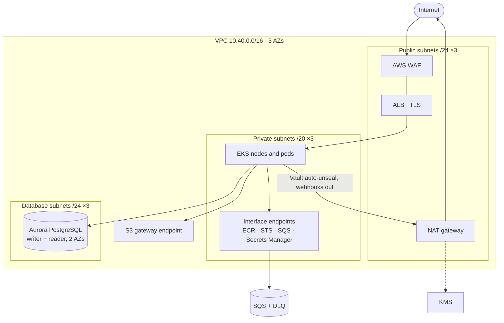
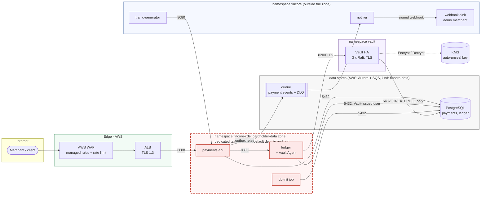
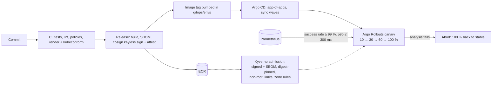
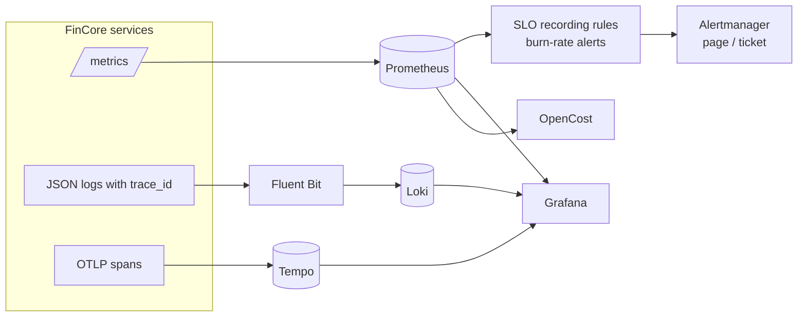

# Architecture

How FinCore is built, from the network down to a single payment. Each view
links to the code that implements it; the reasons behind the main choices are
in [`docs/adr/`](adr/README.md).

- [Network (AWS)](#network-aws)
- [Cluster: namespaces and node pools](#cluster-namespaces-and-node-pools)
- [Cardholder-data zone (CDE) boundary](#cardholder-data-zone-cde-boundary)
- [Payment flow](#payment-flow)
- [GitOps and release flow](#gitops-and-release-flow)
- [Database credentials](#database-credentials-no-static-password-for-the-ledger)
- [Admission path](#admission-path-what-may-run-in-fincore-namespaces)
- [Observability](#observability)
- [Backups and restore](#backups-and-restore)

## Network (AWS)

One VPC (10.40.0.0/16) over three availability zones of ap-southeast-1
([`terraform/modules/network`](../terraform/modules/network/main.tf)). Nodes
and pods live in private subnets; only the ALB and the NAT gateway are public.
AWS APIs the services call (ECR, STS, SQS, Secrets Manager) are reached
through interface endpoints, S3 through a gateway endpoint, so that traffic
never crosses the internet.



Security groups mirror the NetworkPolicies: Aurora admits only the CDE nodes'
security group (attached by the CDE NodePool, [ADR 0001](adr/0001-karpenter-over-cluster-autoscaler.md))
and the system nodes', where Vault runs.

## Cluster: namespaces and node pools

| Namespace | What runs there | Nodes |
|---|---|---|
| `fincore-cde` | payments-api, ledger (Vault Agent sidecar), db-init | CDE NodePool: tainted, on-demand, one per AZ |
| `fincore` | notifier, webhook-sink (demo merchant), traffic generator | General NodePool (Spot first) |
| `vault` | Vault (3 nodes, Raft), injector, snapshot job | AWS: system node group, one per AZ (Aurora admits these nodes); kind: general |
| `monitoring` | Prometheus, Alertmanager, Grafana, Loki, Tempo, Fluent Bit (every node) | General (Fluent Bit also on CDE nodes) |
| `argocd`, `argo-rollouts`, `kyverno`, `cert-manager`, `external-secrets`, `velero`, `opencost` | Platform controllers | General |
| `kube-system` | Karpenter, CoreDNS, AWS Load Balancer Controller, EBS CSI | System node group (3 × m7g.large, managed) |
| `fincore-data` (kind only) | PostgreSQL and ElasticMQ, the stand-ins for Aurora and SQS | kind workers |

On kind the same layout runs on four containers: a control plane, two
general workers labelled zones a and b, and one tainted CDE worker in zone c.

## Cardholder-data zone (CDE) boundary

Everything that processes payments or holds money movements lives in namespace
`fincore-cde`, on dedicated tainted nodes, behind default-deny NetworkPolicies
for both directions. Each arrow below is an explicit allow rule; everything else
is dropped. [`scripts/demo-netpol.sh`](../scripts/demo-netpol.sh) proves it.



| From → to | Why it is allowed | Rule |
|---|---|---|
| ALB (public subnets) / traffic generator → payments-api:8080 | the public API | `payments-api-ingress` |
| payments-api → ledger:8080 | posting double-entry transactions | `ledger-ingress`, `payments-api-egress` |
| payments-api → PostgreSQL:5432, queue (kind 9324 / AWS SQS endpoint 443) | payments and the transactional outbox | `payments-api-egress` |
| payments-api → Pod Identity agent (AWS) | SDK credentials for SQS | `payments-api-egress` |
| ledger → PostgreSQL:5432, Vault:8200 | its database, its credentials | `ledger-egress` |
| any zone pod → kube-dns:53 | name resolution | `allow-dns` |
| Prometheus → :9090 | metrics (canary analysis) | `allow-metrics-scrape` |
| *anything else, including the internet* | **denied** | `default-deny` |

On AWS the same boundary also holds one layer down. Aurora's security group
admits only the CDE node security group and the system node security group
(Vault). Karpenter's ordinary workload nodes don't carry either group.

## Payment flow

```mermaid
sequenceDiagram
  autonumber
  participant C as Client
  participant A as payments-api
  participant P as Card processor
  participant L as ledger
  participant DB as PostgreSQL (payments)
  participant Q as SQS
  participant N as notifier
  participant M as Merchant
  C->>A: POST /v1/payments (Idempotency-Key)
  A->>DB: claim key (or replay the stored answer)
  A->>P: authorize
  A->>DB: status authorized
  A->>P: capture
  A->>L: POST /v1/transactions (balanced: debit receivable, credit merchant and fees)
  L-->>A: 201 (or the same transaction again: idempotent on payment id)
  A->>DB: status captured + outbox event, one transaction
  A-->>C: 201 captured
  loop relay (every replica, SKIP LOCKED)
    A->>DB: unpublished events
    A->>Q: SendMessageBatch
    A->>DB: mark published
  end
  N->>Q: receive
  N->>M: signed webhook (retries; DLQ after maxReceiveCount)
```

A retry with the same `Idempotency-Key` returns the stored answer byte for
byte; a technical failure releases the key so the retry resumes from the
payment's current state. The ledger's database rejects any transaction whose
entries do not balance, and entries can never be updated or deleted.

## GitOps and release flow



On kind, `scripts/deploy-kind.sh` plays CI's part (build, sign with a local
key, push to the local registry, commit the tag) and an in-cluster git server
serves this repository to Argo CD.

## Database credentials: no static password for the ledger

```mermaid
sequenceDiagram
  autonumber
  participant L as ledger pod
  participant A as Vault Agent (sidecar)
  participant V as Vault
  participant P as PostgreSQL

  Note over A: token with audience "vault"<br/>(projected; the Kubernetes API rejects it)
  A->>V: login (Kubernetes auth, role ledger)
  V-->>A: Vault token (policy ledger-db: read database/creds/ledger)
  A->>V: read database/creds/ledger
  V->>P: CREATE ROLE "v-…" LOGIN VALID UNTIL +TTL IN ROLE ledger; SET role = ledger
  V-->>A: username + password, lease TTL (3 min on kind, 1 h on AWS)
  A->>L: render /vault/secrets/db.json
  L->>P: new connections read the file (DB_CREDENTIALS_FILE)
  Note over A,V: before the lease ends: new user, file re-rendered
  L->>P: recycled connections (DB_MAX_CONN_LIFETIME) use the new user
  V->>P: lease expired: terminate leftover sessions, DROP ROLE "v-…"
```

- Dynamic users act as the stable `ledger` role (`SET role`). Tables created
  by migrations are therefore owned by `ledger`, and dropping an expired user
  never strands objects.
- Vault connects as `vault_admin`, which has `CREATEROLE` plus admin on `ledger`
  and nothing else. Its bootstrap password is rotated by Vault on first use.
- Every issuance is in Vault's audit log with the requesting service account.

## Admission path: what may run in FinCore namespaces


## Observability



Grafana's data sources link both ways: a log line's `trace_id` opens the
trace, a span opens its service's log lines. Dashboards (business, service
RED, SLOs, platform) are generated from `dashboards/generate.py`. Spans leave
the CDE through one more explicit NetworkPolicy; they carry ids, routes,
status codes and timings, never card data.

## Backups and restore

| What | How | Where | Every |
|---|---|---|---|
| Secrets not in git (kind: emulated Secrets Manager, KMS seed) | Velero | Backup bucket (kind: SeaweedFS outside the cluster) | 15 min |
| Vault | Raft snapshot, snapshot-only Kubernetes-auth role | Backup bucket | 15 min |
| PostgreSQL | AWS: Aurora continuous backups (PITR, 7 days); kind: `pg_dumpall` | AWS: Aurora; kind: backup store | AWS: continuous; kind: 15 min |

`scripts/kind-up.sh --restore` rebuilds a cluster from the store: Argo CD
holds back everything that needs restored data, Velero restores the secrets,
Vault gets its snapshot (same KMS key, so it unseals with its original
keyring), PostgreSQL gets its dump, and the hold is released. The drill and
its RTO/RPO: [`docs/evidence/phase-3/dr-drill.md`](evidence/phase-3/dr-drill.md).
