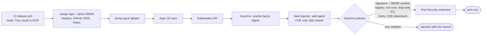

# Architecture

This document grows with each phase. Phase 2 adds the cardholder-data zone,
the credential flow and the admission path. The network, GitOps and
observability views arrive with Phase 3 and the final docs.

## Cardholder-data zone (CDE) boundary

Everything that processes payments or holds money movements lives in namespace
`fincore-cde`, on dedicated tainted nodes, behind default-deny NetworkPolicies
for both directions. Each arrow below is an explicit allow rule; everything else
is dropped. [`scripts/demo-netpol.sh`](../scripts/demo-netpol.sh) proves it.


| From → to | Why it is allowed | Rule |
|---|---|---|
| ALB (public subnets) / traffic generator → payments-api:8080 | the public API | `payments-api-ingress` |
| payments-api → ledger:8080 | posting double-entry transactions | `ledger-ingress`, `payments-api-egress` |
| payments-api → PostgreSQL:5432, queue (kind 9324 / AWS SQS endpoint 443) | payments and the transactional outbox | `payments-api-egress` |
| payments-api → Pod Identity agent (AWS) | SDK credentials for SQS | `payments-api-egress` |
| ledger → PostgreSQL:5432, Vault:8200 | its database, its credentials | `ledger-egress` |
| any zone pod → kube-dns:53 | name resolution | `allow-dns` |
| Prometheus → :9090 | metrics (canary analysis) | `allow-metrics-scrape` |
| *anything else, including the internet* | **denied** | `default-deny` |

On AWS the same boundary also holds one layer down. Aurora's security group
admits only the CDE node security group and the system node security group
(Vault). Karpenter's ordinary workload nodes don't carry either group.

## Database credentials: no static password for the ledger

```mermaid
sequenceDiagram
  autonumber
  participant L as ledger pod
  participant A as Vault Agent (sidecar)
  participant V as Vault
  participant P as PostgreSQL

  Note over A: token with audience "vault"<br/>(projected; the Kubernetes API rejects it)
  A->>V: login (Kubernetes auth, role ledger)
  V-->>A: Vault token (policy ledger-db: read database/creds/ledger)
  A->>V: read database/creds/ledger
  V->>P: CREATE ROLE "v-…" LOGIN VALID UNTIL +TTL IN ROLE ledger; SET role = ledger
  V-->>A: username + password, lease TTL (3 min on kind, 1 h on AWS)
  A->>L: render /vault/secrets/db.json
  L->>P: new connections read the file (DB_CREDENTIALS_FILE)
  Note over A,V: before the lease ends: new user, file re-rendered
  L->>P: recycled connections (DB_MAX_CONN_LIFETIME) use the new user
  V->>P: lease expired: terminate leftover sessions, DROP ROLE "v-…"
```

- Dynamic users act as the stable `ledger` role (`SET role`). Tables created
  by migrations are therefore owned by `ledger`, and dropping an expired user
  never strands objects.
- Vault connects as `vault_admin`, which has `CREATEROLE` plus admin on `ledger`
  and nothing else. Its bootstrap password is rotated by Vault on first use.
- Every issuance is in Vault's audit log with the requesting service account.

## Admission path: what may run in FinCore namespaces


