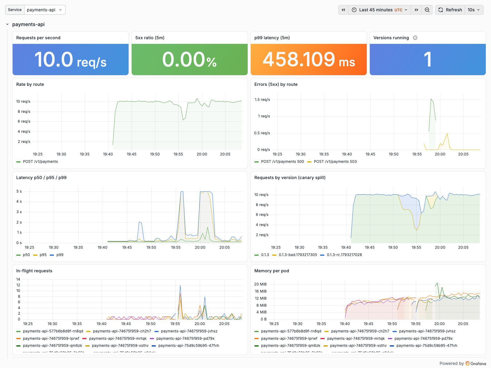
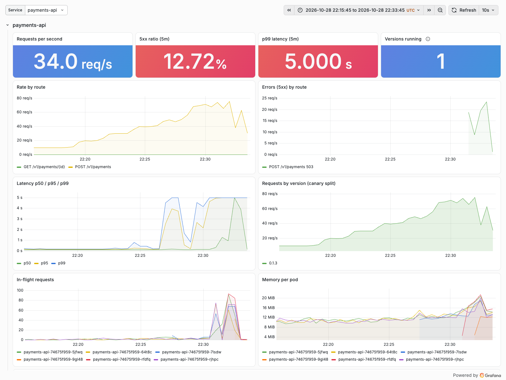

# Phase 3 results: reliability, observability, cost

All acceptance criteria were checked on 2026-10-28 in **one unattended run on a fresh cluster**: `scripts/kind-down.sh && scripts/kind-up.sh`, then every check in order. Raw output is in [`docs/evidence/phase-3/`](evidence/phase-3/), and [`run-timeline.log`](evidence/phase-3/run-timeline.log) has the timeline (19:22 to 22:13 UTC).
- The run started from commit `6453d57`. One fix was committed during it (`7f8b5ea`: the RED dashboard's service variable stayed empty), and that screenshot was retaken.
- A second, calm load test ran after the run on the restored cluster, because the run's own load test came right after the chaos suite on a CPU-saturated VM. Both are published ([C3](#c3-load-test)).

**Environment**
- Docker Desktop VM with 6 CPUs and 10 GB on a laptop.
- kind 0.33.0, `kindest/node:v1.36.4`.
- One control plane (capped at 2 CPUs), two general workers (zones a and b), and one tainted cardholder-data-zone worker (zone c).
- Everything runs together: Phases 1–2, and Prometheus, Alertmanager, Grafana, Loki, Fluent Bit, Tempo, OpenCost, Velero and the backup jobs.

| # | Criterion | Result |
|---|---|---|
| C1 | Observability end to end | **Pass.** One payment was followed from its Tempo trace (spans from payments-api and the ledger) to its Loki log lines, and Grafana's derived field links each line to its trace. Its ledger entry balances. 4 dashboards and 4 data sources are provisioned. |
| C2 | SLOs with burn-rate alerts that fire on a real incident and resolve | **Pass.** The `promtool` rule tests pass (healthy, outage and recovery, latency, imbalance, total outage). In the chaos run the pages fired, were routed to `page`, and all resolved by 21:19 UTC. |
| C3 | Load test towards 300/s, highest sustained rate measured | **Measured.** 300/s is not reachable on this laptop. **30 payments/s is sustained within the SLOs** (p99 237 ms, 0 errors). Up to ~70/s is served without errors but with a multi-second p99; it collapses at ~100/s. Right after the chaos suite, the same VM already saturated at 40/s. |
| C4 | Chaos with SLO impact; 2 postmortems | **Pass.** Pod kill, node drain, DB restart and zone loss each recovered, with the ledger balanced and the outbox drained. Client-side and server-side impact and budget burn are measured. Two postmortems are in `docs/postmortems/`. |
| C5 | DR drill with RTO/RPO | **Pass.** **RTO 18 min 14 s**, **RPO 8 min 36 s**. Every payment older than the dump was back, the ledger is balanced, and Vault has 3/3 nodes unsealed with its original data. |
| C6 | Cost | **Pass.** OpenCost runs on kind. [`docs/cost.md`](cost.md): $1.43/h, $34.33/day idle at AWS list prices, 3 of 9 nodes on Spot, **$0.046 per 1,000 payments** at demo load. `scripts/up.sh` / `down.sh` are statically checked. |
| C7 | Docs | **Pass.** README as a case study, `docs/architecture.md`, 5 ADRs with "considered, not chosen", 6 runbooks, `docs/demo-script.md`, `docs/portfolio.md`. |
| C8 | Phases 1–2 still hold; every static check green | **Pass.** e2e, NetworkPolicy isolation, 11 admission cases, credential rotation (0 errors), a good release promoted and a bad one rolled back; `make check` green, including the Go tests against PostgreSQL. |

## C8: Phases 1 and 2 still hold

On the fresh cluster, with the whole Phase 3 platform added:

| Check | Result | Log |
|---|---|---|
| `kind-up.sh` | everything Synced and Healthy, Vault initialised, 1,069 s | [kind-up.log](evidence/phase-3/kind-up.log) |
| End to end | payment → ledger → outbox → queue → signed webhook; idempotency, double entry, declines | [e2e.log](evidence/phase-3/e2e.log) |
| Zone isolation | every allowed flow open, every other blocked | [netpol.log](evidence/phase-3/netpol.log) |
| Admission | 10 non-compliant workloads rejected with their reason; the signed one admitted by digest | [policies.log](evidence/phase-3/policies.log) |
| Credential rotation | Vault-issued users rotated under load: 1,833 ledger and 1,933 payments-api requests, **0 5xx, 0 restarts** | [rotation.log](evidence/phase-3/rotation.log) |
| Good release | promoted 10 → 30 → 60 → 100 % in 255 s | [demo-good-release.log](evidence/phase-3/demo-good-release.log) |
| Bad release (50 % HTTP 500) | **aborted automatically** 212 s after the commit (Argo CD picked it up in 109 s, analysis failed it 103 s later) | [demo-bad-release.log](evidence/phase-3/demo-bad-release.log) |
| `make check` | all green: Go vet/tests (race, PostgreSQL)/lint, Terraform fmt/validate/tflint/checkov, Helm lint, kubeconform (kind and AWS), 27 Kyverno tests, dashboards up to date, `promtool` SLO tests, actionlint, shellcheck, and the new assertion that the Vault injector fails closed | [check.log](evidence/phase-3/check.log) |

## C1: observability

`make demo-observability` ([log](evidence/phase-3/observability.log)) sends one payment with a sampled `traceparent` and asserts every link:

- **Tempo:** trace `f7566870…` has spans from payments-api (`POST /v1/payments`, `payments.Create`, the HTTP call) and the ledger (`POST /v1/transactions`).
- **Loki:** both services' log lines carry the same `trace_id`. Grafana's Loki data source extracts it with `"trace_id":"([0-9a-f]{32})"`, which is the link to the trace.
- **Ledger:** the payment's capture is debited 4,200 and credited 4,079 + 121 (fee), balanced.
- **Grafana:** the Business, Service RED, Platform and SLO dashboards (generated by `dashboards/generate.py`) are provisioned, with Prometheus, Alertmanager, Loki and Tempo as data sources. Payments are flowing and the ledger imbalance is exactly 0.

|  |  |
|---|---|

## C2 and C4: SLOs, alerts and chaos

`make chaos` ([report](evidence/phase-3/chaos.md), [log](evidence/phase-3/chaos.log)). Before the first experiment, the script waits until no page is firing, so every page in the timeline was caused by an experiment. A k6 probe on an untouched node sends 5 payments/s and records every answer (client side). The services' own metrics give the server side.

| Experiment | Fault | Client availability | Longest client-visible outage | Server 5xx / requests | Monthly budget burned | Ledger balanced / outbox drained |
|---|---|---:|---:|---:|---:|:---:|
| Pod kill (payments-api and ledger, no grace) | 1 s | 100 % | 0 s | 1 / 1,902 | 0 % | yes / yes |
| Node drain (zone a, PDBs respected) | 214 s | 95.4 % | 7.0 s | 249 / 3,970 | 0.63 % | yes / yes |
| PostgreSQL restart (an Aurora failover on AWS) | 14 s | 95.7 % | 6.4 s | 62 / 2,094 | 0.24 % | yes / yes |
| Zone loss (zone c, the whole CDE, frozen 4 min) | 241 s | 37.3 % | 242.8 s | 380 / 2,419 | 9.29 % | yes / yes |

Alerts during the run (Alertmanager, polled every 15 s):

| Alert | Severity | Firing | Routed to |
|---|---|---|---|
| `PaymentsAvailabilityBudgetBurn` | page | 20:40 → 21:19 (node drain, then zone loss; resolved once the 30-minute window was clean) | `page` |
| `PaymentsAPIUnavailable`, `LedgerUnavailable` | page | 20:47 → 20:49 (zone loss started 20:45:02: paged ~2 min in, resolved when the zone came back) | `page` |
| `PaymentsAvailabilityBudgetBurn`, `PaymentsLatencyBudgetBurn` | ticket | open at the end (slow-burn by design) | `ticket` (inhibited while the page fired) |

What the experiments showed:
- **Zone loss is a total outage on kind.** It has one CDE node. On AWS the CDE NodePool, payments-api and the ledger spread over three AZs (`DoNotSchedule`).
- **The node drain cost Vault its quorum for about 2 minutes on kind.** Vault's anti-affinity is relaxed to "preferred" on kind, so two of its three nodes shared the drained node. One was evicted, its local volume pinned it to that node, and the PodDisruptionBudget held the other. The ledger's 3-minute database user then expired before Vault could issue a new one: 241 ledger errors. On AWS, one Vault node per AZ is enforced and credentials live an hour.
- **Draining zone a also evicted Prometheus**, which has no volume on kind, so its history before 20:37 was lost (visible on the dashboard). On AWS it is on an encrypted volume.
- **A database restart costs a few seconds of errors.** The first chaos trial found it cost 2 minutes, because connection attempts had no timeout and held every pool slot. That became [postmortem 2](postmortems/2026-10-28-db-restart-two-minute-outage.md), and `DB_CONNECT_TIMEOUT` fixed it.
- **Events:** 35,394 were published from the outbox and 35,361 received by the notifier while the window was open. The outbox drained after every experiment.

Postmortems: [the ledger's own safety check took payments down](postmortems/2026-10-28-ledger-invariant-scan.md) (load test) and [a 6-second database restart caused 2 minutes of failed payments](postmortems/2026-10-28-db-restart-two-minute-outage.md) (chaos).

## C3: load test

k6 runs as a Job in the cluster and steps the offered rate up. Each step is judged server-side over the last 90 s of its 2-minute hold: p99 ≤ 300 ms, 5xx ≤ 0.1 %, and served ≥ 95 % of offered. Background traffic (10/s) is included in "offered".

**Calm cluster** (after the run, on the restored cluster: [report](evidence/phase-3/loadtest-calm/loadtest.md)):

| Offered | Served | p50 | p95 | p99 | 5xx | Within SLO |
|---:|---:|---:|---:|---:|---:|:---:|
| 20 | 19.9 | 123 ms | 149 ms | 191 ms | 0 % | yes |
| **30** | **30.1** | 125 ms | 172 ms | **237 ms** | 0 % | **yes** |
| 40 | 39.9 | 127 ms | 193 ms | 357 ms | 0 % | no (p99) |
| 50 | 49.3 | 141 ms | 2.7 s | 5 s+ | 0 % | no |
| 70 | 67.3 | 142 ms | 3.8 s | 5 s+ | 0 % | no |
| 100 | 58.2 | 2.7 s | 5 s+ | 5 s+ | 27 % | no |

**In the evidence run**, straight after the chaos suite ([report](evidence/phase-3/loadtest.md)), the same steps failed from the start: p99 was 433 ms at 30/s and 8 % 5xx at 40/s. Node CPU was at 100 % from the 40/s step ([platform dashboard](evidence/phase-3/grafana-platform-loadtest.png)), so the laptop VM itself was the limit.

**Why it stops there.** At 30/s the platform uses about 1.5 of the VM's 6 CPUs. The tail grows first: in the trials, the single PostgreSQL stand-in's commits queued on WAL flushes. Then the VM's CPU saturates, with autoscaled pods and the whole observability stack sharing it. Errors stay at 0 % up to ~70/s. Before this phase's readiness, connection-budget and connect-timeout fixes, the same overload cascaded into errors from 50/s ([postmortem 1](postmortems/2026-10-28-ledger-invariant-scan.md)). 300/s needs a real database (Aurora's storage is built for concurrent commits) and real nodes. That is a demo-day measurement on AWS, not something to fake here.

## C5: disaster recovery drill

`make dr-drill` ([report](evidence/phase-3/dr-drill.md), [log](evidence/phase-3/dr-drill.log)). The cluster was deleted at 21:53:38 while payments were flowing, then rebuilt with `scripts/kind-up.sh --restore` from the backup store, which lives outside the cluster:

| | |
|---|---|
| **RTO** (disaster to the first successful payment) | **18 min 14 s**. Most of it is pulling images into brand-new nodes and Argo CD's sync waves. The restore stages themselves took 14 min 31 s, of which the data steps took seconds. |
| **RPO** | **8 min 36 s**: the newest PostgreSQL dump and Vault snapshot, from the 21:45 run of the 15-minute schedule |
| Payments | 122,016 before; 117,729 back, including **all 117,665 created before the dump**; 4,287 made after it were lost, within the RPO |
| Ledger | imbalance 0 before and 0 after |
| Vault | restored into one node from its Raft snapshot, unsealed by the original KMS key; the other two joined: **3/3 unsealed**, policies, auth and database engine intact; the ledger got fresh credentials |

Restore order (`scripts/restore.sh`):
1. Argo CD holds back everything that needs restored data.
2. Velero restores the secrets: the emulated Secrets Manager entries and the KMS seed.
3. Vault: restore the snapshot into a single node and restart it.
4. PostgreSQL: load the dump.
5. Release the hold.

Trial drills before this run found and fixed the ordering problems (see the [decisions log](decisions-log.md)).

## C6: cost

[`docs/cost.md`](cost.md), built from the AWS public price list for ap-southeast-1 (fetched 2026-10-28, every price with its SKU and source file):

- **Idle:** $1.43/h, **$34.33/day**, about $1,030 a month.
- **Spot share:** 3 of 9 nodes, 23 % of node cost.
- **Per 1,000 payments:** **$0.046** at demo load (10/s), $0.019 at 30/s.
- **OpenCost on kind** (every node priced as an m7g.large): $0.20 allocated to workloads over the 71 minutes of chaos and load test ([allocation](evidence/phase-3/opencost-allocation.json)).
- **`scripts/up.sh` and `scripts/down.sh`:** an ordered create, and an ordered destroy that removes what controllers created (ALBs, Karpenter nodes, volumes) before `terraform destroy`, then checks that nothing billable is left. Both are shellchecked and never run.

## What Phase 3's tests found and fixed

The point of load, chaos and DR tests is what they find. Each finding below has a test or a check, and was released through the normal canary path (one emergency promotion is logged):

1. The ledger's imbalance check scanned the whole ledger on every replica every 15 s ([postmortem](postmortems/2026-10-28-ledger-invariant-scan.md)).
2. Readiness depended on a free database connection, so pods flapped under load.
3. Connection pools multiplied by autoscaling outgrew the database; there is now a connection budget.
4. Connection attempts had no timeout: a 6-second database restart caused 2 minutes of failures ([postmortem](postmortems/2026-10-28-db-restart-two-minute-outage.md)).
5. **The Vault injector never failed closed** (a Phase 2 values key the chart had renamed). It does now, and `make check` asserts it.
6. Argo CD sync waves could run ahead of a dependency that had not synced yet.
7. Disaster-recovery ordering issues: backup naming, Velero during a restore, Vault's restore into a single node, and a verified snapshot copy.
8. Platform sizing on kind: Grafana's memory, the repo server's probes, and Argo CD upgrades with client-side apply.
9. On AWS (static only): Vault could never have scheduled its third node on a 2-node system group.

Each is in the [decisions log](decisions-log.md) and the plan's [as-built section](plans/phase-3.md#as-built-deviations-and-what-the-work-found).
