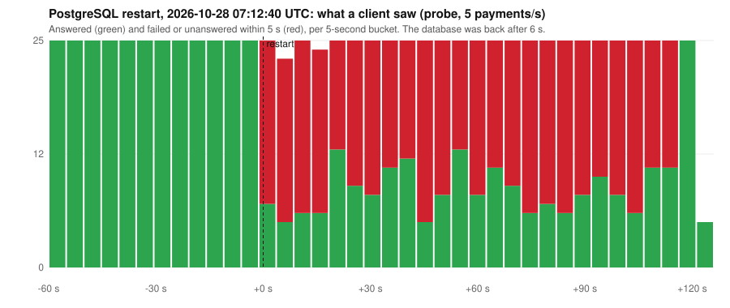

# Postmortem: a 6-second database restart caused 2 minutes of failed payments

| | |
|---|---|
| Date | 2026-10-28, 07:12:40 to 07:14:42 UTC (kind demo environment, chaos experiment `db-restart`) |
| Impact | Synthetic traffic only. For 2 minutes, **58 % of the probe's payments failed** (393 of 677 in the experiment window). Server-side: 773 of 1,225 `POST /v1/payments` answered 5xx. This one restart burned **3 % of the monthly error budget**. |
| Data | Nothing lost: the ledger stayed balanced and the outbox delivered every event once the database was back (`chaos-results.json`) |
| Detection | The chaos script's client probe; the `PaymentsAvailabilityBudgetBurn` page |
| Format | Blameless |

## Summary

The chaos suite restarts PostgreSQL to stand in for an Aurora failover on AWS. The database pod was deleted and was **ready again 6 seconds later**. Payments should have failed for those 6 seconds and recovered at once. Instead, about half of them kept failing for **two minutes**.

The cause was the services' database connection pool. A connection attempt had **no timeout of its own**: a dial to the old database address, which had just disappeared, waited out the kernel's TCP SYN retries, about 2 minutes. While it waited, it held one of the pool's 5 connection slots. A connection attempt outlives the request that started it, because the pool keeps it so the next request can use it. Within seconds of the restart, a payments-api pod's slots were all held by dials that could never succeed, and every request on that pod queued behind them until the client gave up.

The ledger, on the same database, logged a single error. Why its pool escaped is not proven: most likely it opened no new connection during the few seconds the old address was still being dialled, since on kind it health-checks its connections every 2 s. The fix covers both services either way.

## Timeline (UTC)

| Time | |
|---|---|
| 07:12:40 | Chaos experiment `db-restart`: `kubectl delete pod postgres-0` |
| 07:12:41 | "terminating connection due to administrator command", then "the database system is shutting down": expected |
| 07:12:42 | "connection refused" and "connection reset by peer" while the pod restarts: expected |
| 07:12:46 | PostgreSQL ready again (6 s) |
| 07:12:52 – 07:14:42 | payments-api: 713 requests end in "create payment: context canceled". They waited for a pool connection until the client timed out. The outbox relay also fails to connect. |
| 07:14:42 | The stuck dials end: "dial error: timeout". The pool connects at once; payments recover |
| 07:21 | Pages still firing after the experiment (the 6 h / 30 m burn-rate pair holds for about 30 minutes, as designed) |
| 07:22 | Fix committed: `DB_CONNECT_TIMEOUT` (5 s), unit-tested |
| 07:23 – 07:28 | Released as ledger 0.1.3, then payments-api 0.1.3, both through their canaries |
| 07:29 | Re-test: the same restart (database back in 6 s) costs **2 failed payments out of 1,702** in the following 3 minutes |

## Graph

What the probe saw, from 60 s before the restart to 2 minutes after (raw data: [`data/2026-10-28-db-restart-probe.csv`](data/2026-10-28-db-restart-probe.csv)):

## Contributing factors

- **No connect timeout.** pgx bounds a new connection only by the caller's context. Connections opened for the pool itself (health checks, replacing a broken connection) use a context without a deadline, so a dial to a dead address waits for the kernel to give up.
- **Pool slots are held by connection attempts.** That is correct pool behaviour (it bounds connections to the database). Combined with unbounded dials, though, it turns one bad address into a stalled pool.
- **A 5-connection pool per pod** (chosen a few hours earlier for the connection budget) left little room. With 10 the same thing would have happened, only with more slots to fill.
- **Nothing tested a database restart before.** Phase 1 and 2 tested pod kills and bad releases, never the database going away underneath the services.

## What went well

- **The design held on correctness:** idempotency keys, a balanced ledger, the transactional outbox. 2 minutes of errors and no inconsistent money.
- The client-side probe measured exactly what users saw. The server-side metrics alone would have shown the 5xx, but not the 5-second client timeouts.
- **The alerts fired correctly:** a page on availability burn, routed to the `page` receiver.
- From a trace-less symptom ("context canceled") to the root cause took about 20 minutes, thanks to the error logs in Loki with exact timestamps.

## Action items

| | Action | Status |
|---|---|---|
| 1 | `DB_CONNECT_TIMEOUT` (default 5 s) bounds every new connection: dial, TLS and startup | Done (payments-api 0.1.3, ledger 0.1.3), unit-tested against a server that never answers |
| 2 | Database restart as a standing chaos experiment, with a client-side probe | Done (`scripts/chaos.sh`) |
| 3 | AWS: run `scripts/chaos-aws.sh db-failover` (Aurora failover, endpoint DNS change) on the first demo day; the DNS path differs from a pod restart | Open |
| 4 | Trace database calls (pgx tracer): the stalled pool was invisible in traces (shared with postmortem 2026-10-28 ledger, action 6) | Open |
