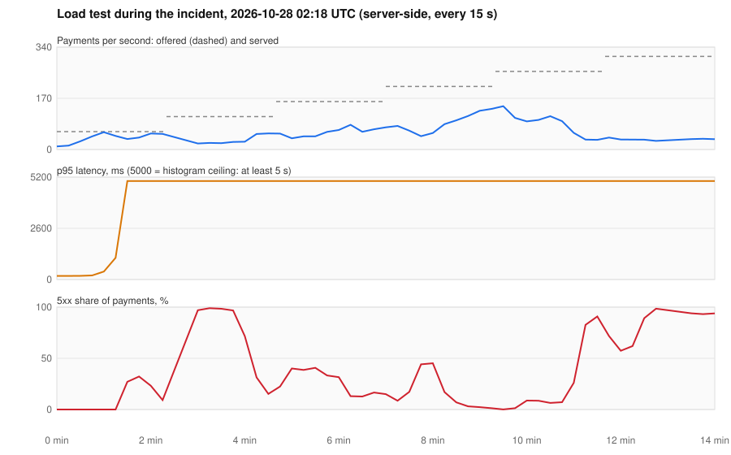

# Postmortem: the ledger's own safety check took payments down

| | |
|---|---|
| Date | 2026-10-28, 01:57 to 03:07 UTC (kind demo environment, found by the Phase 3 load test) |
| Impact | Synthetic traffic only, no real customers. At 10 payments/s, up to 65 % of payments answered 503 at the worst point. The load test reached no step within the SLOs, even at 59 payments/s. |
| Data | No payment was lost or double-charged. The ledger stayed balanced throughout (imbalance 0 on every check), and the outbox delivered every event. |
| Detection | The load test's per-step report, then the canary analysis, which aborted three releases. |
| Severity | Would have been SEV-1 in production: payments unavailable |
| Format | Blameless. The point is what the system allowed to happen, not who did what. |

## Summary

Three problems stacked up under load:

1. **Connection pools vs. the database.** Every pod opened up to 10 database connections. Autoscaling took the services to 14 pods and about 150 connections. The kind PostgreSQL stand-in (512 Mi) was OOM-killed four times in a minute.
2. **Readiness probes that depend on the database.** `/readyz` pinged PostgreSQL through the same pool the requests use. Under load the ping waited for a connection and the probe timed out. Pods dropped out of the Service (payments-api down to 1 of 5 ready), and the survivors took all the traffic.
3. **The ledger-wide invariant check.** Every ledger replica summed all ledger entries every 15 seconds to export the "imbalance must be 0" gauge. At 533,000 entries and up to 8 replicas, five to seven of these scans ran at once, each taking 17 seconds. They saturated the database's CPU and disk reads (28 MB/s), so every commit queued behind WAL flushes. The cost grew with the data and with the replica count, so the system got slower the longer it ran and the harder it was loaded.

The fix for (3) could not get through the canary. The canary's analysis judged the new build in an environment the old build was breaking, and aborted it twice. It was promoted by hand as an emergency change.

## Timeline (UTC)

| Time | What happened |
|---|---|
| 01:53 | First load-test trial (50 then 150 payments/s). The test script failed on a reporting bug after starting its k6 Job, and the Job kept running. |
| 01:57 | Second trial starts on top of the first, an unplanned double load |
| 01:59–02:00 | PostgreSQL OOM-killed four times (512 Mi limit, about 150 backends). Payments fail with "the database system is not yet accepting connections". |
| 02:00:29 | PostgreSQL recovered. Three ledger pods stay stuck at a 4.5 s p95 for about 2 minutes, then recover. |
| 02:03 | Fix: the stand-in gets 1 Gi; the load test now deletes its Job when it exits |
| 02:06 / 02:12 | Fix: a pool of 5 per pod for the ledger and payments-api, released one canary at a time (both promoted) |
| 02:18–02:33 | Full load test: no step within the SLOs; 21 % 5xx already at 59 payments/s |
| 02:41–02:44 | 80 payments/s: PostgreSQL sessions wait on `WALWrite`/`WalSync`; payments-api drops to 1 of 5 ready pods; traces show 2–20 s spent before any downstream call |
| 02:41 | Fix: readiness gates on the database only until it is first reached |
| 02:43–02:50 | Release ledger 0.1.1 (readiness fix): canary aborted, success rate 85 % and 79 %. The stable version is failing just as much: the platform is degraded at 10 payments/s with no load test running. |
| 02:50–02:55 | Diagnosis: `EXPLAIN ANALYZE` of the imbalance query takes 17 s; 5–7 copies run at once; disk reads at 28 MB/s |
| 02:52 | Fix: one fleet-wide check per minute, claimed atomically in the database |
| 02:53–03:00 | Release ledger 0.1.2: canary aborted twice (success 58 %, 84 %); 65 % of payments failing |
| 03:00:16 | Emergency change: canary retried and fully promoted by hand (logged in `docs/decisions-log.md`) |
| 03:03:57 | Ledger 0.1.2 fully rolled out |
| 03:07 | Recovered: 503s down from 2.8/s to 0.25/s, disk reads from 28 to 3 MB/s, one imbalance check per minute fleet-wide, imbalance 0 |

## Graphs

Server-side figures recorded by the load test during the incident (Prometheus, every 15 s), from `docs/postmortems/img/2026-10-28-load-test-collapse.svg`:

## Contributing factors

- **A check that scales with the data, run by every replica.** The imbalance gauge was correct and cheap at the size it was tested at. Nothing limited how often it ran across the fleet, and autoscaling (ledger 2 → 8 pods) multiplied it exactly when the database was busiest.
- **Readiness coupled to a shared dependency.** The probe asked "can I get a database connection right now?". Under load the honest answer is "not within 2 s", and Kubernetes then removed healthy pods, which concentrated the load further.
- **No connection budget.** Pods × pool size was never compared with what the database could hold.
- **Database time was invisible in traces.** A 20-second request with no child spans was the hardest symptom to explain; the database calls are not traced.
- **The canary judges absolute thresholds.** That is the right default, because it blocks bad builds. But when the stable version is the cause, the analysis cannot tell a fix from a regression.

## What went well

- The double-entry design held: every transaction is balanced by database constraints, so no money was created or lost, even through four database crashes.
- Canary analysis kept unproven builds out three times. The one exception was a deliberate, logged decision.
- Tracing (Tempo) showed where the time went: the ledger's server span took 96 ms while its client span took 2.4 s.
- The load test's report made the regression impossible to miss: every step, every number, measured server-side.

## Action items

| | Action | Status |
|---|---|---|
| 1 | Imbalance check once per minute across all replicas (`invariant_checks` claim) | Done (ledger 0.1.2) |
| 2 | Readiness gates on dependencies only until they are first reached | Done (ledger 0.1.2, payments-api 0.1.2) |
| 3 | Connection budget: pool of 5 per pod, at most 100 connections at maximum replicas, written next to the setting | Done |
| 4 | kind database stand-in sized for the budget (1 Gi) | Done |
| 5 | Load test deletes its own Job on exit | Done |
| 6 | Trace database calls (pgx tracer), so time spent in the database or waiting for a connection is visible | Open |
| 7 | Incremental imbalance check (running totals plus a watermark) before the ledger reaches tens of millions of entries | Open |
| 8 | Canary runbook: when the stable version is the incident, an emergency promotion needs a named owner and a note in the change log | Done (`docs/runbooks/canary-rollback.md`) |
